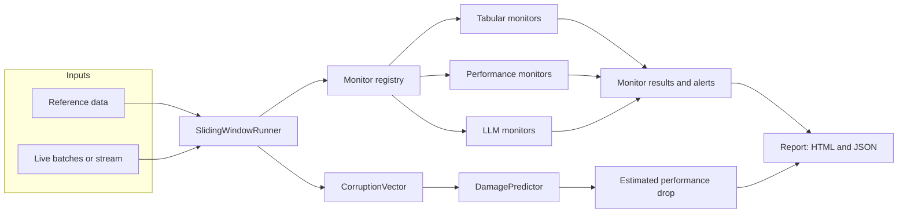
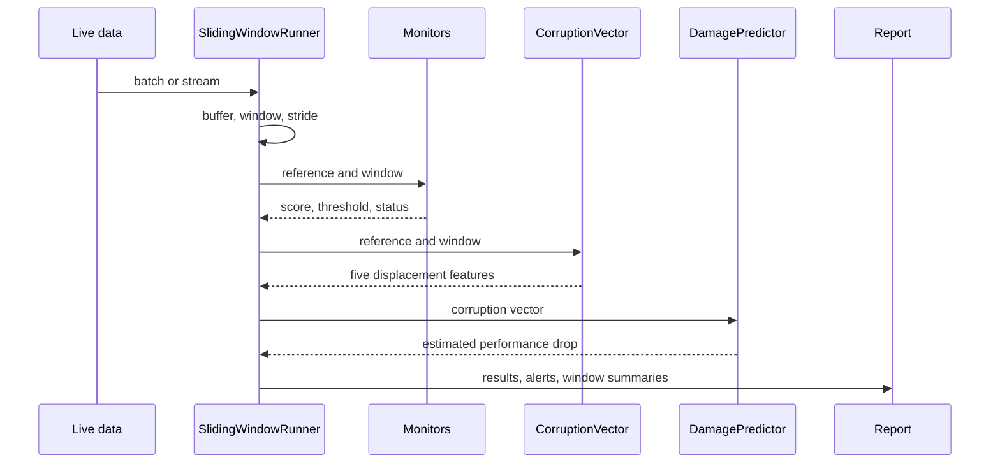
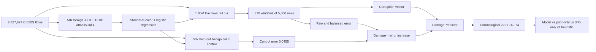

# Driftalytics

Driftalytics is an embeddable drift-monitoring library for tabular machine-learning models
and LLM applications. It evaluates live data over sliding windows, raises per-monitor
alerts, and estimates expected model damage before ground-truth labels arrive.

The project is built around one idea: a production model can keep serving predictions
while its inputs move away from the data it was trained on. Dashboards stay green, jobs
succeed, and quality drops silently. Driftalytics turns that displacement into a small,
inspectable vector and uses it as an early-warning signal.

> Status: v0.5.0, early development. APIs may change before 1.0.

## What it does

- Watches reference data against live batches or an incoming stream.
- Runs 13 built-in monitors across tabular drift, model performance, and LLM quality.
- Reports `ok`, `skipped`, or `error` for every monitor instead of inventing a score.
- Builds a five-feature corruption vector for each window.
- Converts that vector into an estimated performance drop with a lightweight linear
  damage predictor.
- Produces self-contained HTML and JSON reports, with every dynamic value escaped.
- Keeps LLM judging bounded by a token budget, sampling rate, cache, and retry policy.

## Architecture



The runner owns windowing, threshold resolution, alert collection, and report assembly.
Monitors stay small and focused on one measurement. The corruption vector and damage
predictor are optional and only computed when a run needs them.

## How a run works



`run()` scores one batch or a sequence of windows. A non-sliding run treats the entire
input as one window. A sliding run emits full windows at each stride and, when
`include_partial=True`, one trailing partial window. Reports and alerts carry absolute
`start` and `end` offsets into the input. `update()` accepts data incrementally and returns
a report when a window fills. `final=True` flushes an allowed partial window once; later
finalization calls return no reports. `run_stream()` turns an iterable of batches into an
iterator of window reports. Overlapping windows are counted once when the report computes
analyzed rows, and rows skipped by a stride larger than the window size are counted as
skipped.

## The corruption vector

Each window is summarized without labels:

| Feature | Meaning |
|---|---|
| `drift_magnitude` | Maximum PSI across numeric column distributions |
| `missingness_delta` | Mean change in missing-value rate |
| `cardinality_shift` | Change in distinct values against expected sample cardinality |
| `schema_change` | Fraction of columns added, removed, or retyped |
| `volume_delta` | Row-count deviation from the expected window size |

The damage predictor is a linear model trained on corruption vectors paired with measured
performance loss. Models are stored as validated JSON, not pickles. The predictor can also
run untrained as a fixed-weight heuristic, which makes the API usable before a project has
enough labeled damage data.

## Monitors

| Monitor | Measures |
|---|---|
| `psi` | Population Stability Index per numeric column |
| `ks` | KS statistic with Benjamini-Hochberg correction and a minimum effect size |
| `wasserstein` | Normalized earth-mover distance per numeric column |
| `missing_rate` | Change in missing-value rate per column |
| `cardinality` | Distinct-value count against expected sample cardinality |
| `chi_square` | Categorical association with BH correction and Cramer's V |
| `volume` | Row-count deviation from the expected window size |
| `schema_change` | Missing, new, or retyped columns |
| `drift_magnitude` | Maximum PSI across numeric columns from the corruption vector |
| `perf_classification` | Accuracy, precision, recall, or weighted F1 drop |
| `perf_regression` | RMSE, MAE, or R-squared change |
| `faithfulness` | LLM answer groundedness against retrieved context |
| `answer_relevance` | LLM answer relevance to the question |

Performance monitors require `y_true` and `y_pred` columns plus a reference score. LLM
monitors require `question`, `context`, and `answer`, plus a configured judge. A monitor's
own threshold is authoritative. The runner's global threshold is only a fallback for
monitors that do not define one.

## Benchmarks

All numbers below were measured on Windows 11 with Python 3.13.5 on consumer laptop
hardware. They are reproducible from the scripts in `benchmarks/`; results will vary by
machine.

### Dataset

The tabular benchmarks use CICIDS2017 network-flow data: 2.8 million real flows with 68
numeric flow features and a binary benign/attack label. July 3 is benign-only and serves
as the reference and control period. July 4-7 contain natural attacks, so drift is not
injected.

| Property | Value |
|---|---|
| Rows | 2,827,677 |
| Features | 68 numeric flow features |
| Labels | Binary `label` plus `attack_label` |
| Period | 2017-07-03 to 2017-07-07 |
| Attack rows | 556,555 |
| License | Apache-2.0 dataset packaging |
| Citation | Sharafaldin et al. 2018, DOI 10.5220/0006639801080116 |
| Cache | `data/raw/cicids2017/CICIDS_Flow.parquet` |
| SHA-256 | `e64f6adf...0dda35` |

The loader downloads the 370 MB parquet on demand, verifies its SHA-256, parses the mixed
timestamp formats, maps `BENIGN` to 0, sorts by time, and casts features to `float32`.
The dataset is not committed. Its Apache-2.0 terms are separate from the library's MIT
license.

Daily composition:

| Day | Rows | Attacks | Attack rate | Attack families |
|---|---:|---:|---:|---|
| 2017-07-03 | 529,450 | 0 | 0.0000 | none |
| 2017-07-04 | 445,641 | 13,832 | 0.0310 | FTP-Patator, SSH-Patator |
| 2017-07-05 | 691,390 | 251,722 | 0.3641 | DoS Hulk, GoldenEye, slowloris, Slowhttptest, Heartbleed |
| 2017-07-06 | 458,483 | 2,216 | 0.0048 | web attacks, Infiltration |
| 2017-07-07 | 702,713 | 288,785 | 0.4110 | Bot, DDoS, PortScan |

### Real throughput

Three monitors (`psi`, `ks`, `missing_rate`) over 5,000 reference rows, window size 1,000,
and a 100,000-row streaming chunk. The batch is cycled from the same data to reach each
size. Sizes up to 100,000 use three timed runs after one warmup (median shown). The 1M
case uses one timed run.

| Rows | Seconds | Rows/sec | Windows | Monitor alerts |
|---:|---:|---:|---:|---:|
| 1,000 | 0.0885 | 11,303 | 1 | 1 |
| 10,000 | 0.8117 | 12,319 | 10 | 14 |
| 100,000 | 8.2652 | 12,099 | 100 | 190 |
| 1,000,000 | 157.3149 | 6,357 | 1,000 | 1,899 |

Per-monitor throughput at 100,000 rows:

| Monitor | Seconds | Rows/sec | Alerts |
|---|---:|---:|---:|
| `psi` | 1.7685 | 56,544 | 91 |
| `ks` | 5.9476 | 16,813 | 99 |
| `missing_rate` | 0.5115 | 195,515 | 0 |

Streaming is faster than a single `run()` call on this dataset. One isolated comparison on
1M rows measured 183 seconds through `update()` versus 266 seconds through `run()`, so the
benchmark uses the streaming path.

### Attack detection

Each day gets a random, exchangeable split of its benign rows: 50,000 for reference and
50,000 for control. The remaining rows are streamed chronologically in 1,000-row windows.
A window is an attack window when at least half of its rows are attacks. The control split
measures false positives under exchangeability; the live stream also contains temporal
benign drift.

| Day | Attack rate | Windows | Attack windows | Control alerts | Live benign alert rate | Attack alert rate |
|---|---:|---:|---:|---:|---:|---:|
| 2017-07-04 | 0.0310 | 345 | 0 | 0/50 | 0.8773 | 0.0000 |
| 2017-07-05 | 0.3641 | 591 | 260 | 0/50 | 0.9225 | 1.0000 |
| 2017-07-06 | 0.0048 | 358 | 0 | 0/50 | 1.0000 | 0.0000 |
| 2017-07-07 | 0.4110 | 602 | 297 | 0/50 | 0.9605 | 1.0000 |
| Pooled | 0.3072 | 1,896 | 557 | 0/200 | 0.9412 | 1.0000 |

Pooled monitor metrics:

| Monitor | Control alert rate | Live benign alert rate | Attack alert rate | AUC | Recall at 5% control FPR |
|---|---:|---:|---:|---:|---:|
| `psi` | 0.0000 | 0.6441 | 1.0000 | 0.9878 | 1.0000 |
| `ks` | 0.0000 | 0.9412 | 1.0000 | 0.9940 | 1.0000 |
| `missing_rate` | 0.0000 | 0.0000 | 0.0000 | 0.5000 | 0.0000 |

The exchangeable control never alerts, so the monitors are not firing on sampling noise.
Live benign traffic still drifts across each day, which is why the default alert rate on
benign windows is high. Treat a default alert as "the distribution moved", not "the model
is damaged". Ranking quality is high: both `psi` and `ks` separate attack windows from
benign windows with AUC above 0.98 and catch every attack window at a threshold calibrated
to 5% control false positives.

July 4 and July 6 contain no majority-attack windows because their attacks are sparse and
spread across mixed windows. Attack recall is therefore only measurable on July 5 and
July 7. `missing_rate` never fires because CICIDS has no missing values.

### Damage prediction

A logistic regression is trained on 50,000 benign July 3 flows plus all 13,832 July 4
attacks, then evaluated on a held-out 50,000-row benign July 3 control. Damage is the
observed increase in classification error over the control error of 0.04548, clipped to
`[0, 1]`. Balanced damage uses balanced error and removes the class-prior component.



Across 370 live windows, mean raw damage is 0.2381, mean balanced damage is 0.2453, 102
windows have zero damage, and 97 exceed 0.5.

| Day | Windows | Raw damage mean | Raw damage median | Raw damage max | Balanced damage mean | Attack share | Drift magnitude |
|---|---:|---:|---:|---:|---:|---:|---:|
| 2017-07-05 | 139 | 0.3542 | 0.0473 | 0.9379 | 0.2782 | 0.3622 | 1.4392 |
| 2017-07-06 | 91 | 0.1526 | 0.0285 | 0.7405 | 0.2860 | 0.0049 | 0.4466 |
| 2017-07-07 | 140 | 0.1784 | 0.0072 | 0.9531 | 0.1860 | 0.4124 | 2.3073 |

July 6 has almost no attacks, yet balanced damage averages 0.2860. Benign traffic itself
drifts enough to hurt balanced accuracy. July 7 has the highest attack share and the
largest drift magnitude, but its median window is nearly undamaged because the attack
families there are concentrated and easy for the classifier.

The five-feature predictor is trained on a chronological 60/20/20 split (222 train, 74
validation, 74 test windows). Test metrics with bootstrap confidence intervals:

| Predictor | Test MAE | Test RMSE | Test R? |
|---|---:|---:|---:|
| Five-feature model | 0.1097 | 0.1710 | 0.7503 |
| Five-feature 95% CI | 0.0833 to 0.1415 | n/a | 0.7507 to 0.8935 |
| Drift-only OLS | 0.0951 | 0.1196 | 0.9252 |
| Prior-only oracle | 0.0604 | 0.0685 | 0.9901 |
| Untrained heuristic | 0.1510 | 0.2151 | 0.7997 |
| Balanced-target model | 0.2006 | 0.2239 | -0.0204 |

Training metrics are MAE 0.0524, RMSE 0.0776, and R? 0.9536. Validation R? is -13.65
because the validation block crosses a regime change and has low target variance; use MAE
0.4483 there rather than R?.

The prior-only row is an oracle: it uses the true window attack share, which is unavailable
at prediction time. It shows that most raw damage in this stream is class-prior movement.
The deployable five-feature model beats the untrained heuristic, but drift magnitude alone
is slightly better on this test slice (MAE 0.0951 versus 0.1097). Missingness, schema, and
volume are constant zero in CICIDS, and cardinality adds more noise than signal here. The
balanced-target model does not generalize (R? -0.0204), so the vector tracks prior-driven
damage better than concept-driven damage.

## Design choices

- **Labels are optional.** Drift and damage signals work on unlabeled batches.
- **Silence is not a result.** Monitors return explicit status and error details.
- **Thresholds belong to monitors.** A global value cannot override a monitor that knows
  its own scale.
- **Statistical tests need effect sizes.** KS and chi-square require both significance and
  a minimum effect before alerting.
- **No hidden runtime stack.** Core dependencies are numpy, pandas, scipy, and pyyaml.
  Parquet input is optional through `pyarrow`. Benchmark scripts use a separate `bench`
  extra with `pyarrow` and `scikit-learn`. Reports use escaped string formatting. Damage
  models use JSON.
- **Window boundaries are explicit.** Reports and alerts carry absolute offsets, and
  partial windows use their real row count for volume and cardinality checks.
- **LLM cost is bounded.** Judging is cached, sampled, retried, and capped by tokens. Failed
  calls consume budget so invalid responses cannot bypass the cap.

## Project layout

```text
src/driftalytics/     library code
  monitors/           tabular, performance, and LLM monitors
  core.py             monitor contract, registry, corruption vector
  runner.py           windowing, streaming, threshold resolution
  damage.py           JSON damage predictor
  datasets.py         benchmark dataset download, cache, and validation
  report.py           HTML and JSON rendering
  llm.py              provider-agnostic judge
benchmarks/           real-data benchmarks
docs/                 architecture, monitors, API, decisions
examples/             example configuration
notebooks/            executable walkthroughs
results/              recorded benchmark outputs
tests/                unit and regression tests
```

## Documentation

- [Getting started](docs/getting-started.md)
- [Architecture](docs/architecture.md)
- [Monitors](docs/monitors.md)
- [LLM evaluation](docs/llm-eval.md)
- [Benchmarking](docs/benchmarking.md)
- [API reference](docs/api-reference.md)
- [Design decisions](docs/decisions.md)
- [Contributing](docs/contributing.md)

## Limitations

- The published benchmark uses one real dataset, CICIDS2017. Attack prevalence moves from
  0% to 41% across days, only `drift_magnitude` and `cardinality_shift` vary, and default
  alerts fire on benign temporal drift. The linear damage model should be retrained on
  deployment-specific labels.
- Detection quality depends on window size, monitor thresholds, and the kind of drift.
- The library has no built-in database, scheduler, or hosted dashboard. It produces
  reports and leaves storage and delivery to the caller.
- LLM judge scores are model outputs, not human ground truth. No human agreement study is
  included.

## License

MIT. See [LICENSE](LICENSE).
