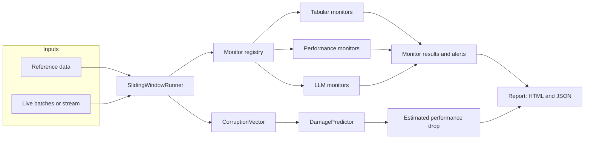
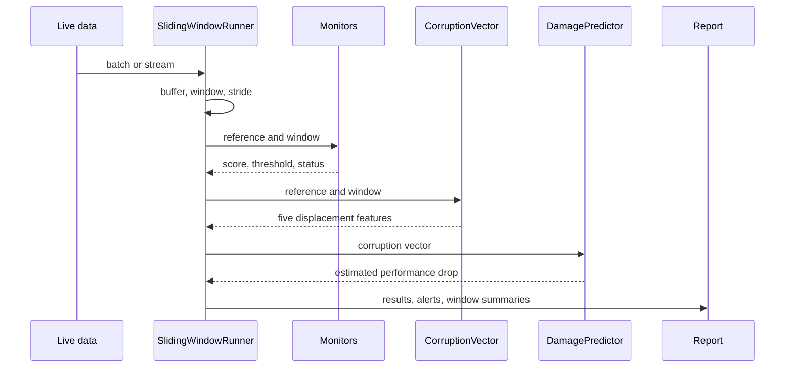
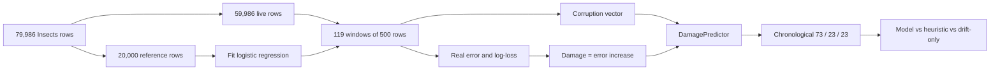

# Driftalytics

Driftalytics is an embeddable drift-monitoring library for tabular machine-learning models
and LLM applications. It evaluates live data over sliding windows, raises per-monitor
alerts, and estimates expected model damage before ground-truth labels arrive.

The project is built around one idea: a production model can keep serving predictions
while its inputs move away from the data it was trained on. Dashboards stay green, jobs
succeed, and quality drops silently. Driftalytics turns that displacement into a small,
inspectable vector and uses it as an early-warning signal.

> Status: v0.4.0, early development. APIs may change before 1.0.

## What it does

- Watches reference data against live batches or an incoming stream.
- Runs 13 built-in monitors across tabular drift, model performance, and LLM quality.
- Reports `ok`, `skipped`, or `error` for every monitor instead of inventing a score.
- Builds a five-feature corruption vector for each window.
- Converts that vector into an estimated performance drop with a lightweight linear
  damage predictor.
- Produces self-contained HTML and JSON reports, with every dynamic value escaped.
- Keeps LLM judging bounded by a token budget, sampling rate, cache, and retry policy.

## Architecture



The runner owns windowing, threshold resolution, alert collection, and report assembly.
Monitors stay small and focused on one measurement. The corruption vector and damage
predictor are optional and only computed when a run needs them.

## How a run works



`run()` scores one batch or a sequence of windows. A non-sliding run treats the entire
input as one window. A sliding run emits full windows at each stride and, when
`include_partial=True`, one trailing partial window. Reports and alerts carry absolute
`start` and `end` offsets into the input. `update()` accepts data incrementally and returns
a report when a window fills. `final=True` flushes an allowed partial window once; later
finalization calls return no reports. `run_stream()` turns an iterable of batches into an
iterator of window reports. Overlapping windows are counted once when the report computes
analyzed rows, and rows skipped by a stride larger than the window size are counted as
skipped.

## The corruption vector

Each window is summarized without labels:

| Feature | Meaning |
|---|---|
| `drift_magnitude` | Mean standardized shift in numeric column means |
| `missingness_delta` | Mean change in missing-value rate |
| `cardinality_shift` | Change in distinct values against expected sample cardinality |
| `schema_change` | Fraction of columns added, removed, or retyped |
| `volume_delta` | Row-count deviation from the expected window size |

The damage predictor is a linear model trained on corruption vectors paired with measured
performance loss. Models are stored as validated JSON, not pickles. The predictor can also
run untrained as a fixed-weight heuristic, which makes the API usable before a project has
enough labeled damage data.

## Monitors

| Monitor | Measures |
|---|---|
| `psi` | Population Stability Index per numeric column |
| `ks` | KS statistic with Benjamini-Hochberg correction and a minimum effect size |
| `wasserstein` | Normalized earth-mover distance per numeric column |
| `missing_rate` | Change in missing-value rate per column |
| `cardinality` | Distinct-value count against expected sample cardinality |
| `chi_square` | Categorical association with BH correction and Cramer's V |
| `volume` | Row-count deviation from the expected window size |
| `schema_change` | Missing, new, or retyped columns |
| `drift_magnitude` | Mean standardized numeric shift from the corruption vector |
| `perf_classification` | Accuracy, precision, recall, or weighted F1 drop |
| `perf_regression` | RMSE, MAE, or R-squared change |
| `faithfulness` | LLM answer groundedness against retrieved context |
| `answer_relevance` | LLM answer relevance to the question |

Performance monitors require `y_true` and `y_pred` columns plus a reference score. LLM
monitors require `question`, `context`, and `answer`, plus a configured judge. A monitor's
own threshold is authoritative. The runner's global threshold is only a fallback for
monitors that do not define one.

## Benchmarks

All numbers below were measured on Windows 11 with Python 3.13.5 on consumer laptop
hardware. They are reproducible from the scripts in `benchmarks/`; results will vary by
machine.

### Dataset

The tabular benchmarks use the Insects `incremental_abrupt_balanced` stream from the USP
Data Stream Repository. It contains real optical-sensor measurements of disease-vector
insects with 33 numeric features and six classes. The row order is curated by the dataset
authors to include incremental, abrupt, and reoccurring drift. It is not a calendar-time
stream.

| Property | Value |
|---|---|
| Rows | 79,986 |
| Features | 33 numeric sensor features |
| Classes | 2, 3, 4, 5, 11, 12 |
| License | CC BY 4.0 |
| Citation | Souza et al. 2020, DOI 10.1007/s10618-020-00698-5 |
| Cache | `data/raw/insects/insects_incremental_abrupt_balanced.csv` |
| SHA-256 | `c1cd19d4...123188b` |

The loader downloads the 21 MB CSV on demand, verifies its SHA-256, and caches it under
`data/raw/`. The dataset is not committed. Its CC BY 4.0 license is separate from the
library's MIT license.

### Real throughput

Three monitors (`psi`, `ks`, `missing_rate`) over 5,000 reference rows from the real
33-feature stream, window size 1,000, one discarded warmup, and the median of three timed
runs. The batch is cycled from the same stream to reach each size.

| Rows | Seconds | Rows/sec | Alerts |
|---|---|---|---|
| 1,000 | 0.1053 | 9,496 | 1 |
| 10,000 | 1.6426 | 6,088 | 15 |
| 100,000 | 28.2142 | 3,544 | 176 |

The old two-column synthetic table is gone. Its 233k to 6.9M rows/sec range measured a much
smaller frame and is not comparable to this 33-feature workload.

### Natural drift detection

The script uses the first 20,000 rows as reference and the remaining 59,986 as live data. It
runs 500-row sliding windows with five monitors. No corruption is injected.

| Metric | Value |
|---|---|
| Live rows | 59,986 |
| Windows | 119 |
| Runtime | 21.3763 seconds |
| Throughput | 2,806 rows/sec |
| Alerts across windows | 231 |
| Windows with an alert | 119 |
| First alert window | 0 |

Per-monitor alert rates:

| Monitor | Alerts | Alert rate |
|---|---|---|
| `psi` | 93 | 0.7815 |
| `ks` | 119 | 1.0000 |
| `missing_rate` | 0 | 0.0000 |
| `cardinality` | 0 | 0.0000 |
| `drift_magnitude` | 19 | 0.1597 |

The first reference block is already non-stationary, so there is no clean control segment
and no honest false-positive-rate estimate. The benchmark reports detection utility against
realized damage instead.

### Detection utility

For each live window, the script trains a logistic regression on the reference period and
measures classification error. Damage is the absolute error increase over the reference.
Severe damage means a damage above 0.5; 22 of 119 windows qualify.

| Monitor | Alert rate | Precision | Recall |
|---|---|---|---|
| `psi` | 0.7815 | 0.2366 | 1.0000 |
| `ks` | 1.0000 | 0.1849 | 1.0000 |
| `wasserstein` | 1.0000 | 0.1849 | 1.0000 |
| `missing_rate` | 0.0000 | 0.0000 | 0.0000 |
| `cardinality` | 0.0000 | 0.0000 | 0.0000 |
| `drift_magnitude` | 0.1597 | 1.0000 | 0.8636 |

`drift_magnitude` is the only high-precision monitor. It alerts on 19 windows, all severe,
and catches 86% of severe windows. PSI and KS catch every severe window but alert on most
windows. That is the expected trade-off on a strong, sustained drift stream.

### Damage prediction

The damage target is the observed classification-error increase, clipped to `[0, 1]`.
Windows are split chronologically 60/20/20 into 73 train, 23 validation, and 23 test
windows. The five-feature predictor uses `drift_magnitude`, `missingness_delta`,
`cardinality_shift`, `schema_change`, and `volume_delta`.



The five-feature model reaches MAE 0.0530, RMSE 0.0850, and R-squared 0.8790 on the
training windows. Held-out results:

| Predictor | Validation MAE | Test MAE | Test RMSE | Test R² |
|---|---|---|---|---|
| Five-feature model | 0.0224 | 0.0405 | 0.0536 | 0.9525 |
| Drift-only OLS | 0.0284 | 0.0385 | 0.0501 | 0.9605 |
| Untrained heuristic | 0.0410 | 0.1843 | 0.2455 | 0.4198 |

Validation R-squared is numerically unstable because validation damage has low variance;
compare MAE and RMSE there.

Only `drift_magnitude` and `cardinality_shift` vary in this stream. The other three
corruption features are constant zero, and their fitted coefficients are zero. The
drift-only ablation is slightly better on test (MAE 0.0385 versus 0.0405), so this benchmark
validates drift and cardinality damage, not missingness, schema, or volume. The five-feature
model still beats the untrained heuristic by a wide margin.

## Design choices

- **Labels are optional.** Drift and damage signals work on unlabeled batches.
- **Silence is not a result.** Monitors return explicit status and error details.
- **Thresholds belong to monitors.** A global value cannot override a monitor that knows
  its own scale.
- **Statistical tests need effect sizes.** KS and chi-square require both significance and
  a minimum effect before alerting.
- **No hidden runtime stack.** Core dependencies are numpy, pandas, scipy, and pyyaml.
  Parquet input is optional through `pyarrow`. Benchmark scripts use a separate `bench`
  extra with `pyarrow` and `scikit-learn`. Reports use escaped string formatting. Damage
  models use JSON.
- **Window boundaries are explicit.** Reports and alerts carry absolute offsets, and
  partial windows use their real row count for volume and cardinality checks.
- **LLM cost is bounded.** Judging is cached, sampled, retried, and capped by tokens. Failed
  calls consume budget so invalid responses cannot bypass the cap.

## Project layout

```text
src/driftalytics/     library code
  monitors/           tabular, performance, and LLM monitors
  core.py             monitor contract, registry, corruption vector
  runner.py           windowing, streaming, threshold resolution
  damage.py           JSON damage predictor
  datasets.py         benchmark dataset download, cache, and validation
  report.py           HTML and JSON rendering
  llm.py              provider-agnostic judge
benchmarks/           real-data benchmarks
docs/                 architecture, monitors, API, decisions
examples/             example configuration
notebooks/            executable walkthroughs
results/              recorded benchmark outputs
tests/                unit and regression tests
```

## Documentation

- [Getting started](docs/getting-started.md)
- [Architecture](docs/architecture.md)
- [Monitors](docs/monitors.md)
- [LLM evaluation](docs/llm-eval.md)
- [Benchmarking](docs/benchmarking.md)
- [API reference](docs/api-reference.md)
- [Design decisions](docs/decisions.md)
- [Contributing](docs/contributing.md)

## Limitations

- The published benchmark uses one real stream with a curated drift order. Only two of the
  five corruption features vary, the reference period is not stationary, and the linear
  damage model should be retrained on deployment-specific labels.
- Detection quality depends on window size, monitor thresholds, and the kind of drift.
- The library has no built-in database, scheduler, or hosted dashboard. It produces
  reports and leaves storage and delivery to the caller.
- LLM judge scores are model outputs, not human ground truth. No human agreement study is
  included.

## License

MIT. See [LICENSE](LICENSE).
