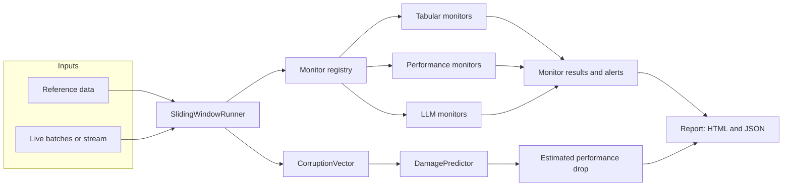
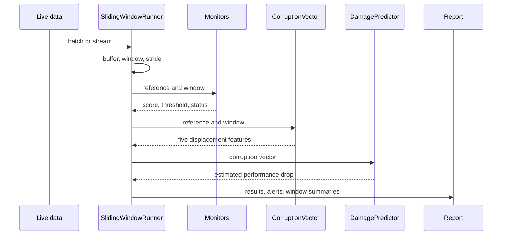
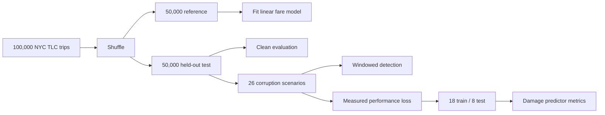

# Driftalytics

Driftalytics is an embeddable drift-monitoring library for tabular machine-learning models
and LLM applications. It evaluates live data over sliding windows, raises per-monitor
alerts, and estimates expected model damage before ground-truth labels arrive.

The project is built around one idea: a production model can keep serving predictions
while its inputs move away from the data it was trained on. Dashboards stay green, jobs
succeed, and quality drops silently. Driftalytics turns that displacement into a small,
inspectable vector and uses it as an early-warning signal.

> Status: v0.2.0, early development. APIs may change before 1.0.

## What it does

- Watches reference data against live batches or an incoming stream.
- Runs 13 built-in monitors across tabular drift, model performance, and LLM quality.
- Reports `ok`, `skipped`, or `error` for every monitor instead of inventing a score.
- Builds a five-feature corruption vector for each window.
- Converts that vector into an estimated performance drop with a lightweight linear
  damage predictor.
- Produces self-contained HTML and JSON reports, with every dynamic value escaped.
- Keeps LLM judging bounded by a token budget, sampling rate, cache, and retry policy.

## Architecture



The runner owns windowing, threshold resolution, alert collection, and report assembly.
Monitors stay small and focused on one measurement. The corruption vector and damage
predictor are optional and only computed when a run needs them.

## How a run works



`run()` scores one batch or a sequence of windows. `update()` accepts data incrementally
and returns a report when a window fills. `run_stream()` turns an iterable of batches into
an iterator of window reports. Overlapping windows are counted once when the report
computes analyzed and skipped rows.

## The corruption vector

Each window is summarized without labels:

| Feature | Meaning |
|---|---|
| `drift_magnitude` | Mean standardized shift in numeric column means |
| `missingness_delta` | Mean change in missing-value rate |
| `cardinality_shift` | Change in distinct values against expected sample cardinality |
| `schema_change` | Fraction of columns added, removed, or retyped |
| `volume_delta` | Row-count deviation from the expected window size |

The damage predictor is a linear model trained on corruption vectors paired with measured
performance loss. Models are stored as validated JSON, not pickles. The predictor can also
run untrained as a fixed-weight heuristic, which makes the API usable before a project has
enough labeled damage data.

## Monitors

| Monitor | Measures |
|---|---|
| `psi` | Population Stability Index per numeric column |
| `ks` | KS statistic with Benjamini-Hochberg correction and a minimum effect size |
| `wasserstein` | Normalized earth-mover distance per numeric column |
| `missing_rate` | Change in missing-value rate per column |
| `cardinality` | Distinct-value count against expected sample cardinality |
| `chi_square` | Categorical association with BH correction and Cramer's V |
| `volume` | Row-count deviation from the expected window size |
| `schema_change` | Missing, new, or retyped columns |
| `drift_magnitude` | Mean standardized numeric shift from the corruption vector |
| `perf_classification` | Accuracy, precision, recall, or weighted F1 drop |
| `perf_regression` | RMSE, MAE, or R-squared change |
| `faithfulness` | LLM answer groundedness against retrieved context |
| `answer_relevance` | LLM answer relevance to the question |

Performance monitors require `y_true` and `y_pred` columns plus a reference score. LLM
monitors require `question`, `context`, and `answer`, plus a configured judge. A monitor's
own threshold is authoritative. The runner's global threshold is only a fallback for
monitors that do not define one.

## Benchmarks

All numbers below were measured on Windows 11 with Python 3.13.5 on consumer laptop
hardware. They are reproducible from the scripts in `benchmarks/`; results will vary by
machine.

### Synthetic throughput

Three monitors (`psi`, `ks`, `missing_rate`) over 5,000 reference rows and two numeric
columns:

| Rows | Seconds | Rows/sec | Alerts |
|---|---|---|---|
| 1,000 | 0.0041 | 244,642 | 0 |
| 10,000 | 0.0155 | 646,768 | 0 |
| 100,000 | 0.0161 | 6,202,512 | 0 |

Fixed pandas overhead dominates small batches. The 100,000-row figure is measured, not
extrapolated to larger inputs.

### Real-data drift detection

The real dataset is NYC TLC yellow taxi trips for January 2024. The benchmark splits
50,000 rows into reference and live halves, applies scale and missingness corruption to
the live half, and evaluates 10 windows of 5,000 rows with five monitors.

| Metric | Value |
|---|---|
| Rows analyzed | 50,000 |
| Windows | 10 |
| Runtime | 0.4994 seconds |
| Throughput | 100,118 rows/sec |
| Alerts across windows | 39 |

Final-window scores:

| Monitor | Score | Threshold | Alert |
|---|---|---|---|
| `psi` | 0.2477 | 0.2 | yes |
| `ks` | 0.2199 | 0.05 | yes |
| `missing_rate` | 0.1526 | 0.05 | yes |
| `cardinality` | 3.3755 | 0.1 | yes |
| `drift_magnitude` | 0.1624 | 0.5 | no |

The cardinality alert comes from `trip_distance`. The reference values repeat after
rounding, so a 5,000-row reference sample contains far fewer distinct values than 5,000.
Adding Gaussian noise makes nearly every live value unique. The score compares against
expected sample cardinality, so the window size alone is not the cause.

### Detection and damage prediction



The clean linear fare model uses `trip_distance`, `trip_distance` squared,
`passenger_count`, `payment_type`, `PULocationID`, and `DOLocationID`. It reaches MAE
4.3848, RMSE 11.2272, and R-squared 0.7439 on the held-out half.

| Case | Any-alert rate |
|---|---|
| Clean windows | 0.0 |
| Corrupted windows | 1.0 |

Per-monitor alert rate on the corrupted run:

| Monitor | Clean | Corrupted |
|---|---|---|
| `psi` | 0.0 | 1.0 |
| `ks` | 0.0 | 1.0 |
| `wasserstein` | 0.0 | 1.0 |
| `missing_rate` | 0.0 | 1.0 |
| `cardinality` | 0.0 | 0.0 |
| `drift_magnitude` | 0.0 | 0.0 |

The corrupted scenario scales trip distance by 1.6 and makes 15% of passenger counts
missing. Cardinality and drift magnitude did not cross their thresholds for this
corruption. Read the detection rate as a scenario result, not a general claim.

The damage predictor is fitted on 18 of 26 simulated corruption scenarios and evaluated
on the remaining 8:

| Metric | Value |
|---|---|
| MAE | 0.2536 |
| RMSE | 0.3140 |
| R-squared | 0.4299 |

The target is the relative RMSE increase over the clean model, clipped to `[0, 1]`. Eight
held-out scenarios is a small sample. The R-squared is indicative, not a guarantee.

## Design choices

- **Labels are optional.** Drift and damage signals work on unlabeled batches.
- **Silence is not a result.** Monitors return explicit status and error details.
- **Thresholds belong to monitors.** A global value cannot override a monitor that knows
  its own scale.
- **Statistical tests need effect sizes.** KS and chi-square require both significance and
  a minimum effect before alerting.
- **No hidden runtime stack.** Core dependencies are numpy, pandas, scipy, and pyyaml.
  Reports use escaped string formatting. Damage models use JSON.
- **LLM cost is bounded.** Judging is cached, sampled, retried, and capped by tokens.

## Project layout

```text
src/driftalytics/     library code
  monitors/           tabular, performance, and LLM monitors
  core.py             monitor contract, registry, corruption vector
  runner.py           windowing, streaming, threshold resolution
  damage.py           JSON damage predictor
  report.py           HTML and JSON rendering
  llm.py              provider-agnostic judge
benchmarks/           synthetic and real-data benchmarks
docs/                 architecture, monitors, API, decisions
examples/             example configuration
notebooks/            executable walkthroughs
results/              recorded benchmark outputs
tests/                unit and regression tests
```

## Documentation

- [Getting started](docs/getting-started.md)
- [Architecture](docs/architecture.md)
- [Monitors](docs/monitors.md)
- [LLM evaluation](docs/llm-eval.md)
- [Benchmarking](docs/benchmarking.md)
- [API reference](docs/api-reference.md)
- [Design decisions](docs/decisions.md)
- [Contributing](docs/contributing.md)

## Limitations

- The damage predictor is trained on simulated corruptions in the published benchmark.
  Real deployments need their own labeled damage data.
- Detection quality depends on window size, monitor thresholds, and the kind of drift.
- The library has no built-in database, scheduler, or hosted dashboard. It produces
  reports and leaves storage and delivery to the caller.
- LLM judge scores are model outputs, not human ground truth. No human agreement study is
  included.

## License

MIT. See [LICENSE](LICENSE).
